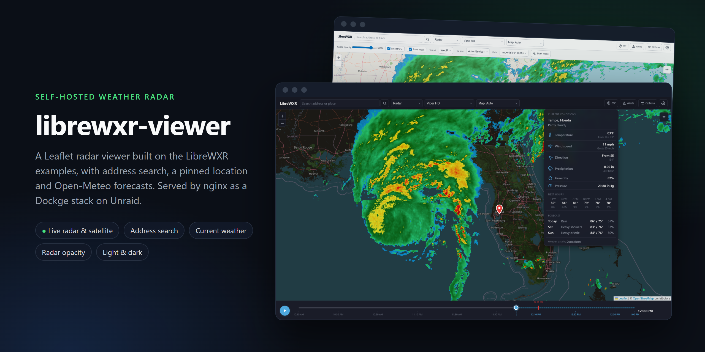
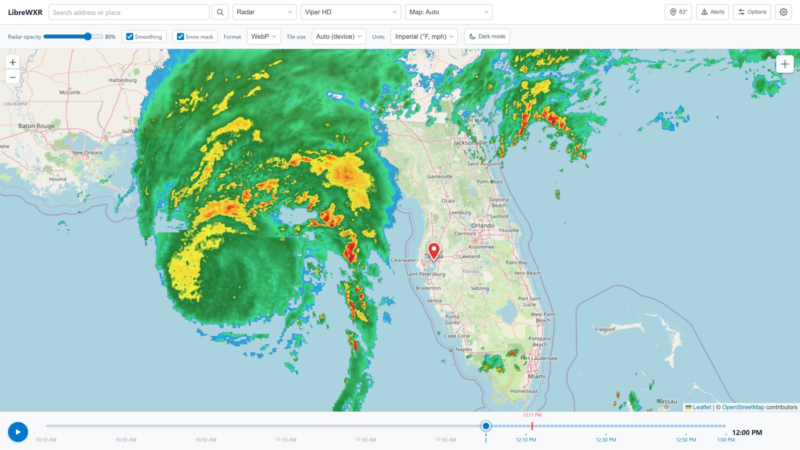

<p align="center">
  
</p>

<p align="center">
  <a href="LICENSE"></a>
  <a href="https://github.com/camyers/librewxr-viewer/commits/main"></a>
  
  <a href="https://github.com/JoshuaKimsey/LibreWXR"></a>
  
  
  
  
</p>

# librewxr-viewer

A self-hosted weather radar page for my home server. It's a static Leaflet viewer that I adapted from the [LibreWXR](https://github.com/JoshuaKimsey/LibreWXR) example viewer, then extended with address search, a pinned location, a current-weather dropdown, a radar opacity slider and a few other quality-of-life changes. nginx serves it as a Dockge stack on Unraid. There's no image to build: the stack runs the stock `nginx:alpine` image and bind-mounts the `html/` folder from this repo.

## Why I built this

On January 1st, 2026, Rain Viewer restricted its free API tier to zoom level 7, one color scheme, and no satellite or forecast frames. That broke the radar page I kept open on my home network. LibreWXR is a self-hostable, drop-in replacement for the Rain Viewer API, and it ships with example viewers that already handle playback, color schemes, alerts and satellite.

I wanted something I could leave running on the Unraid box and open from any device on the network, so I took the Leaflet example and turned it into a small, plain project:

- **No build step.** It's static HTML, CSS and JavaScript, so the repo is the deployment.
- **Managed like any other stack.** Dockge picks it up from its stacks folder, and updating it is a `git pull`.
- **Centered on where I am.** It opens on my pinned location with the local conditions one click away, instead of on a fixed map center.

## Where the original files came from

The viewer started from the Leaflet example in the [`examples/`](https://github.com/JoshuaKimsey/LibreWXR/tree/main/examples) folder of [JoshuaKimsey/LibreWXR](https://github.com/JoshuaKimsey/LibreWXR). These files carry over from that example:

| File | Origin |
| --- | --- |
| `html/js/viewer-core.js` | The library-agnostic viewer engine from `examples/src/viewer-core.js`, with small changes: an `onLocate` callback, a radar opacity setting and an `apiDefault` option |
| `html/js/app.js` | The Leaflet adapter from `examples/src/leaflet.html.js`, moved into its own file and extended |
| `html/index.html`, `html/css/styles.css` | The Leaflet example's markup and styles, split out of the single-file build and extended |

The copy was taken in September 2026 and most closely matches upstream commit [`6347e19`](https://github.com/JoshuaKimsey/LibreWXR/commit/6347e19), so newer example features, such as the lightning overlay, aren't in it yet.

The LibreWXR server is licensed AGPL-3.0, but its `examples/` folder is licensed separately under MIT ([`LICENSE-examples`](LICENSE-examples)). This repo contains only code derived from the examples, no server code, so it uses the same MIT license. The original copyright notice is kept in [`LICENSE-examples`](LICENSE-examples).

Radar and satellite tiles come from a LibreWXR API. By default that's the public instance at `api.librewxr.net`, and the source dropdown can switch to a LibreWXR server you run yourself on `localhost:8080`.

## What I added

**Project structure**
- Split the single-file example into `index.html`, `css/styles.css` and one JavaScript file per feature under `js/`.
- Added a `compose.yaml` that serves `html/` read-only from `nginx:alpine`, so the folder can run as a Dockge stack.
- Changed the default API source to the public LibreWXR instance instead of auto-detecting a local server.

**Location and search** (`js/search.js`, `js/location.js`)
- An address and place search box in the toolbar, backed by OpenStreetMap's Nominatim geocoder. Results fly the map to the place and zoom to fit it.
- A location pin for the searched or "Locate me" position. It's saved in the browser, and the map opens centered on it next time.
- On the first visit with no saved location, the viewer asks the browser for your position. If you decline, it opens on the center of the US.
- Reverse geocoding turns a located position into a readable label, like "Tampa, Florida".

**Current weather** (`js/weather.js`)
- A weather button in the toolbar that shows the current temperature for the pinned location.
- A dropdown with current conditions (temperature and feels-like, wind speed, gusts and direction, precipitation, humidity, pressure), the next 18 hours in 3-hour steps, and a 3-day forecast, with an icon for each reading.
- Data comes from [Open-Meteo](https://open-meteo.com/) with no API key. Responses are cached for 10 minutes, and requests time out after 10 seconds.
- Imperial or metric units, chosen in Options and remembered per browser.

**Display options**
- A radar opacity slider in the Options panel, saved per browser.
- The light/dark toggle moved into Options, with a text label. The chosen theme is remembered between visits.
- A toolbar customization menu (the gear icon) to show or hide each toolbar control, saved per browser (`js/settings.js`).

<p align="center">
  
</p>

## Repo layout

```
librewxr-viewer/
  compose.yaml          # the Dockge stack definition
  LICENSE               # MIT, for this repo's changes
  LICENSE-examples      # MIT, the original LibreWXR examples notice
  docs/images/          # README images
  html/                 # the files nginx serves
    index.html
    css/styles.css
    js/
      viewer-core.js    # LibreWXR viewer engine (playback, layers, alerts)
      app.js            # Leaflet adapter and app startup
      location.js       # pinned location, saved in the browser
      search.js         # Nominatim address search
      weather.js        # Open-Meteo current weather dropdown
      settings.js       # show or hide toolbar controls
```

## Running it

### Dockge on Unraid

This is how I run it. Dockge doesn't pull from git. It manages plain folders: every subfolder of its stacks directory that contains a `compose.yaml` shows up as a stack. So installing it means cloning into that directory.

1. Find the stacks directory. It's `/opt/stacks` by default. If you changed it, check the `DOCKGE_STACKS_DIR` value in the Dockge compose file, and use the path as it exists on the Unraid host.

2. Clone the repo into it:

   ```bash
   cd /mnt/user/appdata/dockge/stacks
   git clone https://github.com/camyers/librewxr-viewer.git
   ```

   The folder name becomes the stack name in Dockge, so keep it as `librewxr-viewer`.

3. Open Dockge, refresh the stack list if the new stack isn't showing, open `librewxr-viewer`, and click Start.

4. Browse to `http://<server-ip>:8089` to confirm it loads.

Dockge resolves `./html` on the host, so the stacks path must be the same inside the Dockge container and on the host. This is the "CORRECT vs WRONG" note in Dockge's own compose file. If the viewer starts but nginx shows its default page or a 403, check this first.

### Any Docker host

```bash
git clone https://github.com/camyers/librewxr-viewer.git
cd librewxr-viewer
docker compose up -d
```

Then open `http://localhost:8089`.

### Without Docker

Any static file server works. For a quick local look:

```bash
python -m http.server 8089 --directory html
```

Browser geolocation only works on `localhost` or over HTTPS, so from another device on the network "Locate me" needs a reverse proxy with TLS. Search works either way.

## compose.yaml

```yaml
services:
  viewer:
    image: nginx:alpine
    ports:
      - 8089:80
    volumes:
      - ./html:/usr/share/nginx/html:ro
    restart: unless-stopped
```

The `:ro` mount means nginx can't write to the folder, so edit files in the repo, not through the container.

## Updating

```bash
cd /mnt/user/appdata/dockge/stacks/librewxr-viewer
git pull
```

nginx reads files from disk, so changes under `html/` are served right away without a restart. If `compose.yaml` changed, open the stack in Dockge and click Update (or Restart) to apply the new definition.

If the stack is lost or the server is rebuilt, repeat the install steps. Nothing else needs a backup: the repo is the source of truth and the container holds no state.

## Optional: friendly hostname

To put this behind Nginx Proxy Manager, add a proxy host that points at the server's IP on port 8089 (websockets aren't needed). Then add a matching DNS rewrite in AdGuard Home so the hostname resolves to NPM.

## Troubleshooting

- **The stack doesn't appear in Dockge:** confirm the folder is directly inside the stacks directory and the file is named `compose.yaml` (or `compose.yml`, `docker-compose.yaml`, `docker-compose.yml`).
- **Port already in use:** change the left side of `8089:80` in `compose.yaml`.
- **403 or the nginx welcome page:** `html/` is missing or empty, or the stacks path mismatch described above applies. Check that `html/index.html` exists on the host.
- **No radar frames:** check the API source dropdown. "Local" expects a LibreWXR server on `localhost:8080` of the machine running the browser.

## Privacy

The viewer has no backend and no analytics. Your pinned location, theme, units, opacity and toolbar choices are stored in your browser's `localStorage` and never leave it, except as follows: searches go to Nominatim, the pinned coordinates (rounded to 4 decimal places) go to Nominatim for a place name and to Open-Meteo for the forecast, and the map view's tiles come from the selected LibreWXR API and base map provider.

## Credits

- [LibreWXR](https://github.com/JoshuaKimsey/LibreWXR) by Joshua Kimsey: the radar API and the example viewer this is built on
- [Leaflet](https://leafletjs.com/) for the map
- [OpenStreetMap](https://www.openstreetmap.org/copyright) contributors for base map data and the [Nominatim](https://nominatim.org/) geocoder; [CyclOSM](https://www.cyclosm.org/), [OpenTopoMap](https://opentopomap.org/) and the [Humanitarian OSM Team](https://www.hotosm.org/) for alternate base maps
- [Open-Meteo](https://open-meteo.com/) for current conditions and forecasts

## License

[MIT](LICENSE), the same license as the LibreWXR examples this is derived from. The original examples notice is in [`LICENSE-examples`](LICENSE-examples).
